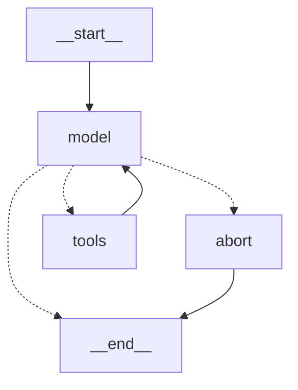

# 手写循环 vs LangGraph：一份对比文档

配套：`stage1/agent.py`（手写，约 280 行）与 `stage4/graph_agent.py`（LangGraph，约 230 行）。
同一个任务、同一个模型、同一套工具，分别跑通。

这份文档回答一个问题：**既然 300 行就能写出 agent 循环，为什么要引入图框架？**

---

## 1. 同一个循环，两种写法

### 手写循环（阶段 1）

```python
def run(self, user_input: str) -> str:
    self.messages.append({"role": "user", "content": user_input})
    for turn in range(1, MAX_TURNS + 1):
        resp = client.chat.completions.create(
            model=MODEL, messages=self.messages,
            tools=tool_schemas(), temperature=0.0,
        )
        message = resp.choices[0].message
        tool_calls = message.tool_calls or []

        self.messages.append(assistant_message(message))   # 原始调用请求也要入历史
        if not tool_calls:                                 # 停止条件 1：没有工具调用
            return message.content
        for call in tool_calls:                            # 执行 + 回填
            result = execute_tool(call.function.name, call.function.arguments)
            self.messages.append({"role": "tool", "tool_call_id": call.id,
                                  "content": result})
    return "达到最大轮次"                                   # 停止条件 2
```

控制流一眼可见：**一个 for 循环 + 两个分支**。你完全知道下一行会发生什么。

### 图（阶段 4）

```python
builder = StateGraph(AgentState)
builder.add_node("model", call_model)
builder.add_node("tools", call_tools)
builder.add_node("abort", abort)
builder.add_edge(START, "model")
builder.add_conditional_edges(
    "model", after_model, {"tools": "tools", "abort": "abort", END: END}
)
builder.add_edge("tools", "model")
builder.add_edge("abort", END)
graph = builder.compile()
```

执行时：

```python
state = graph.invoke({"messages": [...], "turns": 0, ...}, config)
```

循环没有消失，它只是被**声明**成了"节点 + 边"。真正的循环由框架的调度器跑。

### 状态怎么流动

手写版本直接改 `self.messages`。图版本用 reducer 声明"新消息追加到列表"：

```python
class AgentState(TypedDict):
    messages: Annotated[list[Message], operator.add]
```

节点只返回增量：

```python
return {"messages": [assistant], "turns": turn + 1, ...}
```

**这是图式编排最核心的写法差异。** 节点不应该修改共享状态，只返回"这次新增了什么"；
合并规则由 `Annotated[..., reducer]` 决定。理解这一点，LangGraph 就没有魔法了。

---

## 2. 四个维度对比

| 维度 | 手写循环 | LangGraph | 谁更好 |
|---|---|---|---|
| **可读性** | 一个函数读完，控制流线性 | 图结构直观，但需要跨三个函数看状态 | 小流程手写；复杂分支图更清楚 |
| **可控性** | 任何一行都能改 | 受框架调度约束，终止条件要换算成 `recursion_limit` | 手写 |
| **调试难度** | `print` / 断点直接打在循环里 | 需要理解 checkpoint、super-step、reducer | 手写 |
| **扩展性** | 加"人工审批"要自己写状态机和落盘 | `interrupt()` + checkpointer 现成 | 图 |
| **持久化** | 自己序列化 `messages`，自己处理版本 | 每个节点后自动写检查点 | 图 |
| **依赖** | 只要 `openai` | LangGraph + LangChain Core + checkpoint 包 | 手写 |
| **可迁移性** | 换厂商 = 改消息格式 | 换厂商仍要改消息格式；图本身不解决这个 | 平手 |

### 可读性：取决于流程复杂度

- 3 个节点以内：手写循环短、直白，图的样板代码（State、builder、边）反而占篇幅。
- 10 个节点、有分支/并行/人工介入：手写会退化成一个几百行的 `if/elif` 状态机，
  图的"边"比嵌套条件更容易看懂。

### 可控性：手的边界更清楚

手写循环里，停止条件是**代码**：

```python
if elapsed > MAX_SECONDS: return abort(...)
if used > MAX_TOKENS: return abort(...)
```

图里，这些要么塞进节点，要么依赖 `recursion_limit`。超时/预算这类横切关注点，
图并不比手写更优雅。**不要为了"用框架"把简单的预算检查复杂化。**

### 调试：图多了一层"看不见的循环"

手写版本出错时，堆栈直接指向 `agent.py` 的某一行。图版本出错时，你要先判断：
是节点逻辑错了，还是边接错了，还是状态没合并对，还是检查点恢复到了旧状态。

LangGraph 的 trace 能力是补偿：每个 super-step 都有记录。但学习成本真实存在。

### 扩展性：这是图真正的价值

本阶段实现的四件事，手写都要额外造轮子：

| 能力 | 手写成本 | LangGraph |
|---|---|---|
| 断点恢复 | 自己序列化状态、自己设计"从哪继续" | `checkpointer` + `thread_id` |
| 人工审批 | 阻塞 `input()` 或自建任务队列 | `interrupt()` + `Command(resume=...)` |
| 并行分支 | 自己 `asyncio.gather` + 合并结果 | 同一 super-step 的多个节点 |
| 流程可视化 | 手画 | `graph.get_graph().draw_mermaid()` |

注意：**并行工具调用不需要图**。`asyncio.gather` 十行就能做（见 `parallel_tools.py`）。
图带来的增量主要是**持久化**和**中断恢复**。

---

## 3. 实测

同一台机器、同一个 `deepseek-chat`、同一个问题：

> 北京现在几点？比东京早还是晚几小时？

| 实现 | 轮次 | 工具调用 | token | 耗时 |
|---|---|---|---|---|
| `stage1/agent.py` | 3 | get_current_time ×2 + calculate ×1 | 2736 | 2.1s |
| `stage4/graph_agent.py` | 2 | get_current_time ×2 | 1879 | 1.2s |

**不要把这个当成"图更快"的证据。** 两次运行的差异主要来自模型自己的决策：
手写版多调了一次 `calculate`，图版直接心算了 1 小时时差。同一实现重复跑也会波动。
这个表的正确读法是：**两种实现的表现处在同一量级**，图没有引入明显的运行时开销。

图的结构可以直接打印：

```bash
uv run python stage4/graph_agent.py --graph
```



---

## 4. 决策清单

### 继续用手写循环，如果：

- 流程就是"模型 → 工具 → 模型"，节点数 ≤ 5；
- 不需要跨进程恢复；
- 你在学习阶段，想看清每一个细节；
- 你不想为了一个功能引入一整套依赖。

**阶段 1 的 300 行 agent 在生产里并不丢人。** 很多内部工具就长这样。

### 引入 LangGraph，如果：

- 需要**断点恢复**：任务可能跑几十分钟，进程会被重启/部署打断；
- 需要**人工审批**：写文件、发请求、扣款前必须停下来等人；
- 流程有**多分支/多角色**，而且分支条件会变；
- 需要**可视化**给非开发者看流程。

### 不要因为下面这些理由引入：

- ❌ "多 agent 听起来更高级"——先证明单 agent + 更多工具解决不了；
- ❌ "框架会自动帮我管上下文"——不会，`ContextManager` 还是得自己写；
- ❌ "用了 LangGraph 就能换模型"——消息格式仍然要适配；
- ❌ "社区项目都用"——你的任务规模可能只有它们的百分之一。

---

## 5. 一句话总结

> **手写循环让你理解 agent 是什么；图框架让你在流程变复杂后还能维护它。**
> 先手写，再上框架；上框架的理由应该是"我需要检查点/中断/分支"，
> 而不是"我想用框架"。

阶段 4 后面的 `checkpoint_demo.py` 和 `hitl_demo.py` 就是那两个理由的具体样子。
